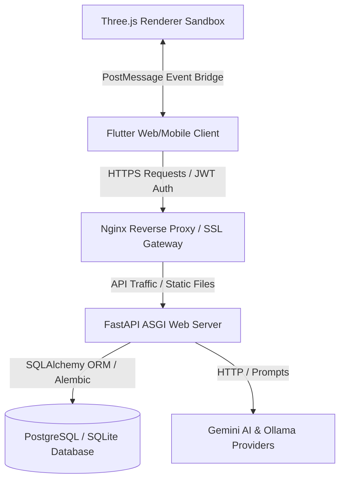
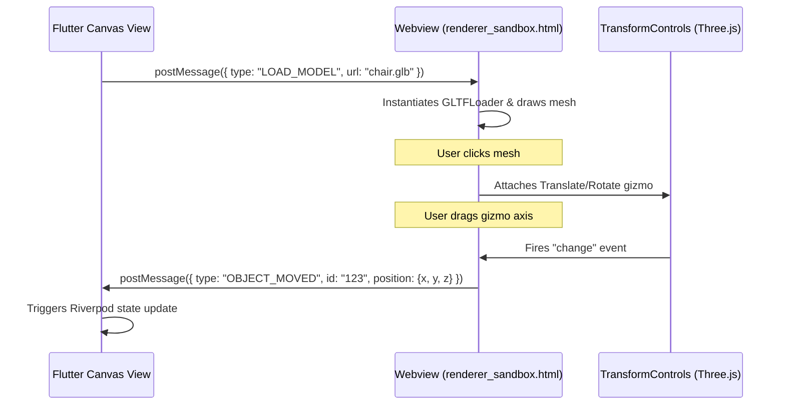

# FlowSpace: Master Developer Handbook & Project Guide

Welcome to the **FlowSpace** developer handbook. This document serves as the absolute source of truth for the project. It provides all background context, engineering decisions, architectural blueprints, database schemas, deployment pipelines, 3D graphics details, and onboarding instructions for new developers.

---

## 📖 Table of Contents
1. [🌟 Executive Summary & Why FlowSpace](#1-executive-summary--why-flowspace)
2. [📋 Product & Technical Requirements](#2-product--technical-requirements)
3. [💻 Technology Stack](#3-technology-stack)
4. [🏗️ Project Architecture & File Structure](#4-project-architecture--file-structure)
5. [⏳ Development History: How We Built It](#5-development-history-how-we-built-it)
6. [💾 Database Schema Diagrams & Models](#6-database-schema-diagrams--models)
7. [🔌 The GPU 3D Viewport & Flutter Bridge](#7-the-gpu-3d-viewport--flutter-bridge)
8. [📸 360° Mobile Panorama Scanning Pipeline](#8-360-mobile-panorama-scanning-pipeline)
9. [⚙️ Standalone 3D Asset Organizer Tool](#9-standalone-3d-asset-organizer-tool)
10. [🚀 Installation & Running Commands Reference](#10-installation--running-commands-reference)
11. [🐳 Dockerization & Environment Setup](#11-dockerization--environment-setup)
12. [🛡️ Production Readiness, Security, & Backups](#12-production-readiness-security--backups)
13. [🧑‍💻 Contribution & Code Style Guidelines](#13-contribution--code-style-guidelines)

---

## 🌟 1. Executive Summary & Why FlowSpace

### 1.1 The Problem
Interior design, facility planning, and furniture placement are complex tasks. Professionals (architects, designers) and consumers frequently struggle with:
1. **Accidental Violations of Ergonomic Rules**: Placing furniture too close to doors, blocking emergency egresses, or ignoring wheelchair accessibility regulations (ADA compliance).
2. **Disconnected Visualizing Tools**: Switching back and forth between flat 2D blueprints, heavy 3D rendering software, and local inventory catalogs.
3. **Manual Spatial Optimization**: Trial-and-error layouts to determine how many desks can fit in a workspace or how a living room should be oriented.
4. **Messy 3D Asset Libraries**: 3D models downloaded from various online catalogs have inconsistent file formats, incorrect bounding boxes, off-center origins, and missing thumbnails.

### 1.2 The Solution
**FlowSpace** is a unified, intelligent, cross-platform spatial design application. It integrates dynamic 2D canvas editors and 3D GPU-accelerated viewports with a real-time **Ergonomic Design Validation Engine** and a **Gemini AI Layout Optimizer**. FlowSpace enables users to capture real-world rooms using mobile panorama cameras, build designs using a normalized asset catalog, score layouts for safety and aesthetics, and run AI solvers to discover optimized furniture configurations.

---

## 📋 2. Product & Technical Requirements

FlowSpace is engineered around a series of key functional specifications:

| Requirement ID | Module | Description |
| :--- | :--- | :--- |
| **MOD-001** | Authentication & RBAC | Secure email registration/login with JWT token pairs (120-min access, 7-day refresh), session revocation in DB, and Role-Based Access Control (`Administrator`, `Interior Designer`, `Architect`, `Customer`, `Guest`). |
| **MOD-002** | Dashboard & Analytics | Unified project hub displaying recent templates, favorite designs, spatial metrics, activity logs, and system metrics. |
| **MOD-003** | Project & Room Management | Full CRUD operations for projects and multi-room structures (naming, location, styles, metric/imperial unit toggles). Supports full duplication of projects and rooms. |
| **MOD-004** | Room Dimensions Wizard | Multi-step interactive flow to define geometry (length, width, height, wall thickness, ceiling height) with physical validation limits (bounds > 0). |
| **MOD-005** | Design Validation Engine | Layout evaluation checking clearances, safety/egress blockages, and ADA accessibility. Returns an overall Design Score (0-100) and category subscores. |
| **MOD-006** | Dynamic Furniture Catalog | Searchable, paginated asset library loading glTF models from backend. Supports category filtering, favorites, and recents tracking. |
| **MOD-007** | Interactive 3D Viewport | High-performance Three.js editing sandbox with mouse selection raycasting, hover outlines, bounding box helpers, keyboard shortcuts, world/local space gizmos, snap-to-floor, and collision warning highlights. |
| **MOD-008** | Panorama Scanning | Dart-based compass-guided 360° capture wizard with 6-sector alignment, template-match stitching, and demo fallback simulation. |

---

## 💻 3. Technology Stack

FlowSpace is designed as a modular monorepo utilizing the following components:



### 3.1 Backend Stack
* **FastAPI (Python 3.11+)**: Asynchronous web framework exposing REST endpoints, automatically serving OpenAPI (Swagger) specs.
* **SQLAlchemy (ORM)** & **Alembic**: Database abstraction layer and database migrations manager. Supports local SQLite and production PostgreSQL.
* **Gunicorn & Uvicorn**: Gunicorn manages worker processes in production, spawning Uvicorn ASGI workers for high-concurrency request handling.
* **Pytest**: Backend unit and integration test runner.

### 3.2 Frontend Stack
* **Flutter (Dart SDK 3.x)**: UI framework targeting Web, Android, iOS, and Desktop from a single code base.
* **Riverpod**: State management framework providing compile-safe, readable reactive providers.
* **GoRouter**: Declarative routing system with route guards evaluating JWT presence and roles.
* **Three.js (JavaScript/HTML5)**: Embedded inside a web view wrapper to provide high-performance 3D GPU-accelerated graphics editing via standard WebGL.

### 3.3 Infrastructure & AI Pipeline
* **Docker & Docker Compose**: Automated multi-stage containers for Nginx, FastAPI, and PostgreSQL.
* **Nginx**: Serving compiled static Flutter Web assets, routing API request reverse proxies, handling SSL certificates, and serving gzip and custom HTTP security headers.
* **Gemini API (Google AI)** & **Ollama**: Generative models for layout planning, recommendations, and visual categorization.
* **Blender API (Python)**: Command-line script execution using Blender's headless mode to import, clean, center, ground, and render previews for raw 3D meshes.

---

## 🏗️ 4. Project Architecture & File Structure

FlowSpace uses a strict **Feature-First** architecture. This helps keep code highly cohesive and enables team members to modify individual modules without breaking others.

```
mad2/
├── backend/                       # FastAPI Backend
│   ├── app/                       # Global Configuration & Middleware
│   │   ├── config.py              # Environment variable parser
│   │   ├── dependencies.py        # Shared dependency injections (get_db, current_user)
│   │   ├── main.py                # FastAPI instantiation & route registration
│   │   └── middleware/            # Security headers, metrics tracker, Gzip
│   ├── core/                      # Core Cross-Cutting Concerns
│   │   ├── database/              # SQLite/Postgre connection sessions
│   │   ├── logging/               # Console logger handlers
│   │   └── security/              # JWT tokens & Password bcrypt utilities
│   ├── features/                  # Business Domain Feature Modules
│   │   ├── auth/                  # RBAC models, schemas, services, API endpoints
│   │   ├── project/               # Project CRUD and duplication
│   │   ├── room/                  # Room settings & physical dimensions
│   │   ├── furniture/             # Dynamic catalog, favorites, recents
│   │   ├── validation/            # Design score & ergonomics checker
│   │   ├── ai/                    # Gemini AI layout generators & recommendation
│   │   └── room_reconstruction/   # Panorama upload & estimation
│   ├── migrations/                # Alembic database migrations
│   └── tests/                     # Integration and unit tests
│
├── frontend/                      # Flutter Web & Mobile Client
│   ├── lib/                       # Dart Source Code
│   │   ├── app/                   # Global GoRouter config and AppTheme
│   │   ├── core/                  # Core services, HTTP Clients, URL helpers
│   │   ├── shared/                # Common widgets, ResponsiveLayout wrapper
│   │   └── features/              # Feature Modules (Auth, Designer, Furniture, etc.)
│   │       └── presentation/      # UI components & Riverpod controllers
│   ├── web/                       # Web entry points
│   │   └── renderer_sandbox.html  # Three.js 3D Viewport Sandbox
│   └── test/                      # Flutter widget and unit tests
│
├── tools/                         # Offline Dev Utilities
│   └── asset_organizer/           # Standalone Blender/Python 3D Asset Organizer
│
└── scripts/                       # Database backup and maintenance tools
```

---

## ⏳ 5. Development History: How We Built It

The codebase evolved iteratively through major milestones, ensuring that changes remained stable and test-backed at each step:

1. **Authentication & RBAC**: Developed base DB schemas. Set up password cryptography, access/refresh token rotation, and FastAPI role guards. Configured the Flutter Riverpod auth provider and GoRouter guards to block access.
2. **Dashboard & Project CRUD**: Added Project models. Configured search, status filters (Draft, Archived, Deleted), soft-deletes, and deep duplication of projects including their rooms and configurations.
3. **Room Dimensions & Spatial Logic**: Implemented rooms schemas and measurements tables. Set up API rules validating that length, width, and height are positive floats. Created Flutter wizards with interactive sliders and forms.
4. **Design Validation Engine**: Added rule sets to evaluate layout safety. Programmed accessibility, lighting, ergonomic, space utilization, and furniture balance calculations on the backend. Integrated warning sidebars and one-click item navigation ("Locate") in Flutter.
5. **Asset Catalog**: Designed a catalog system parsing category, subcategory, style, and sizes. Coded favorites, recents, and paginated searches.
6. **3D GPU Viewport Bridge**: Built `renderer_sandbox.html` to load GLB assets. Configured click raycasting, TransformControls gizmos, world/local space shortcuts, snap-to-floor boundary constraints, collision boxes, and sent events back to Flutter using `window.parent.postMessage`.
7. **Mobile Panorama Scanner**: Developed a compass-guided Dart capture flow for Android devices. Wrote fallback stitching recovery templates and simulator mode.
8. **Docker & Proxy Configuration**: Created optimized Dockerfiles. Configured Nginx to reverse proxy API paths to bypass CORS issues, and configured dynamic hostnames.
9. **Production Tuning**: Swapped FastAPI direct boot with Gunicorn production workers (4 workers). Enabled HTTPS, strict security headers, liveness/readiness probes, metrics middleware, and backup scripts.

---

## 💾 6. Database Schema Diagrams & Models

FlowSpace's schema maps authentication, project trees, layouts, catalog inventories, and user logs.

### 6.1 Authentication Module Models
Exposed in [backend/features/auth/models.py](file:///c:/Users/Admin/Documents/mad2/backend/features/auth/models.py):

* **`roles`**: System permissions grouping. Automatically seeded with `Administrator`, `Interior Designer`, `Architect`, `Customer`, and `Guest`.
* **`users`**: Records full name, email, password hash, status (verified/active), and foreign key to `roles.id`.
* **`user_preferences`**: Toggles layout parameters (Theme, Language, Measurement Unit, default room units, notifications) and loads automatically on startup.
* **`user_sessions`**: Session ledger mapping tokens to active/revoked states. Used to immediately invalidate JWTs on logout.
* **`audit_logs`**: Immutable ledger recording user actions (login, password change, account deletion).

### 6.2 Project & Room Management Models
Exposed in [backend/features/project/models.py](file:///c:/Users/Admin/Documents/mad2/backend/features/project/models.py) and [backend/features/room/models.py](file:///c:/Users/Admin/Documents/mad2/backend/features/room/models.py):

```
┌─────────────────┐       ┌─────────────────┐       ┌─────────────────┐
│     users       │       │    projects     │       │      rooms      │
├─────────────────┤       ├─────────────────┤       ├─────────────────┤
│ id (PK)         │◄─────┐│ id (PK)         │◄─────┐│ id (PK)         │
│ email           │       │ user_id (FK)    │       │ project_id (FK) │
│ full_name       │       │ project_name    │       │ room_name       │
└─────────────────┘       │ status          │       │ room_type       │
                          │ is_favorite     │       │ room_color      │
                          └────────┬────────┘       └────────┬────────┘
                                   │1                        │1
                                   ▼1                        ▼1
                          ┌─────────────────┐       ┌─────────────────┐
                          │project_settings │       │room_measurements│
                          ├─────────────────┤       ├─────────────────┤
                          │ id (PK)         │       │ id (PK)         │
                          │ project_id (FK) │       │ room_id (FK)    │
                          │ grid_enabled    │       │ length, width   │
                          │ snap_enabled    │       │ height          │
                          └─────────────────┘       └─────────────────┘
```

### 6.3 Catalog & Favorites Models
Exposed in [backend/features/furniture/models.py](file:///c:/Users/Admin/Documents/mad2/backend/features/furniture/models.py):

* **`assets`**: Unified file lookup registry documenting local disk paths, URLs, extensions, and file categories (`model`, `texture`, `thumbnail`).
* **`furniture_categories`**: Hierarchical category tree (supports parent-child relationships).
* **`furniture_assets`**: Master furniture inventory documenting dimensions (width, depth, height), safe clearances, assembly margins, styles, tags, and foreign keys to glTF models, thumbnails, and preview assets.
* **`furniture_favorites`**: User-specific table tracking liked items.
* **`furniture_recent`**: Tracking table containing timestamps of the user's recently selected furniture.

---

## 🔌 7. The GPU 3D Viewport & Flutter Bridge

To achieve seamless, desktop-class 3D graphics in a cross-platform environment without bloat, FlowSpace embeds a lightweight, high-performance HTML/JS renderer inside a Flutter container.



### 7.1 Key Features of the Sandbox (`renderer_sandbox.html`)
* **Raycasting Selection**: Translates mouse/tap screen coordinates into virtual 3D coordinates, identifying clicked meshes.
* **Outlines and Hover Indicators**: Highlights objects on hover using `THREE.BoxHelper` with an emissive visual glow.
* **Active Transforms**: Attaches `TransformControls` allowing interactive translation (movement), rotation, and scale.
* **Snap-to-Floor Constraint**: Constrains all transform operations to ground objects at `y = 0` (preventing floating chairs or underground desks).
* **Interactive Collision Check**: Checks bounds against walls and other furniture meshes, changing outline highlight colors to bright red (`0xef4444`) on collisions.
* **Keyboard Shortcuts**:
  * `T`: Translate mode
  * `R`: Rotate mode
  * `S`: Scale mode
  * `Q`: Select mode
  * `W` / `L`: Toggle World/Local coordinates
  * `X` / `Y` / `Z`: Lock individual transform axes
  * `F`: Focus camera on selected object

### 7.2 Message Dispatch Bridge (`viewport_controller.dart`)
Exposed in [viewport_controller.dart](file:///c:/Users/Admin/Documents/mad2/frontend/lib/features/designer/bridge/viewport_controller.dart):
* Listens to the `window.onMessage` stream.
* Catches actions: `OBJECT_SELECTED`, `OBJECT_DESELECTED`, `OBJECT_MOVED`, `OBJECT_ROTATED`, `OBJECT_SCALED`.
* Correctly parses nested coordinate payloads (flat `x,y,z` or nested `position: {x,y,z}`).
* Updates Riverpod `designerProvider` state directly.
* Prevents update loops: During active mouse drags, calls are throttled and synchronized to prevent local state changes from overwriting active UI interactions.

---

## 📸 8. 360° Mobile Panorama Scanning Pipeline

Designed for physical Android/iOS devices, the scanning wizard enables users to capture spatial blueprints using their mobile camera:

1. **Sector Alignment Tracking**: A Flutter camera interface partitions a 360-degree rotation into 6 sectors (`0°`, `60°`, `120°`, `180°`, `240°`, `300°`).
2. **Lock-On Calibration**: The interface uses compass sensors. When alignment is reached, a 500ms countdown initiates, triggering a shutter flash and photo capture.
3. **Template-Matching Stitching Engine**: Captured frames are processed sequentially using feature-matching algorithms to build a 2:1 ratio stitched panorama.
4. **Stitching Failure Recovery**: If feature matches fail (e.g. insufficient lighting, dark textures), the system catches the error, displays diagnostic failure logs, and allows the user to repeat the capture or activate **Demo Simulation Mode**.
5. **Interactive Viewer**: A panoramic viewer supports panning, slider-driven zoom, and viewport resets, passing measurements (Length, Width, Height) directly into the Room CRUD database.

---

## ⚙️ 9. Standalone 3D Asset Organizer Tool

Located in [tools/asset_organizer/](file:///c:/Users/Admin/Documents/mad2/tools/asset_organizer/), this standalone Python command-line utility automates the ingestion of raw 3D assets:

1. **Dual Execution Pipelines**:
   * **Blender Mode (High-Fidelity)**: If configured with a local Blender executable, runs Blender headlessly to import proprietary files (`.blend`, `.fbx`, `.obj`), clean loose vertices, normalize scales, ground mesh roots, and render photorealistic WebP thumbnails.
   * **Pure Python Mode (Headless)**: If Blender is missing, uses lightweight Python loaders to process meshes, outputting flat-shaded wireframe preview PNGs.
2. **AI Visual Classifier**: Passes rendered thumbnails to the Gemini API (`gemini-2.5-flash`) to visually identify objects and categorize them (e.g. `living_room`, `decor`, `lighting`) with details. If no API key is set, falls back to metadata heuristic rules and places models in `needs_review/`.
3. **De-duplication System**: Groups identical file assets by computing SHA256 hashes, and detects variants by matching face/vertex counts and bounding volumes.

---

## 🚀 10. Installation & Running Commands Reference

Follow these instructions to run the application components on a local host machine.

### 10.1 Backend Setup
Requirements: Python 3.11 or 3.12 (standard virtual environment).

```powershell
# Navigate to backend
cd backend

# Create and activate virtual environment
python -m venv .venv
# On Windows (PowerShell):
.venv\Scripts\Activate.ps1
# On macOS/Linux:
source .venv/bin/activate

# Install package dependencies
pip install -r requirements.txt

# Copy and configure environment variables
copy .env.example .env

# Initialize database schemas and seed values (Alembic)
alembic upgrade head

# Launch local FastAPI development server (auto-reloads on edits)
python main.py
```

### 10.2 Backend Testing
Verify backend service behaviors and endpoints using `pytest`:
```powershell
$env:PYTHONPATH="."
pytest tests
```

### 10.3 Frontend Setup
Requirements: Flutter SDK stable channel.

```powershell
# Navigate to frontend
cd frontend

# Retrieve Dart packages
flutter pub get

# Launch Flutter client (Targeting Chrome browser for dev)
flutter run -d chrome

# Run tests
flutter test
```

---

## 🐳 11. Dockerization & Environment Setup

FlowSpace includes Docker Compose configurations to run the entire stack inside containerized environments.

### 11.1 Local Development Environment (Live Reloading)
This setup mounts local directories directly into the containers. This enables live backend reloading and immediate frontend updates after compiling files.

```bash
# Boot the development stack
docker-compose -f docker-compose.dev.yml up --build

# Shutdown the dev stack and wipe volumes
docker-compose -f docker-compose.dev.yml down -v
```
* Dev access port: **`http://localhost:8080`** (Nginx routing traffic to Flutter and API backend).
* Live logs: View output streams in the terminal or use `docker logs -f flowspace_backend_dev`.

### 11.2 Production Stack (HTTPS & Gunicorn)
This containerizes compiled Flutter static sites, runs backend APIs under Gunicorn worker clusters, and initiates SSL traffic.

```bash
# Boot the production stack
docker-compose up --build -d

# Check status of service containers
docker-compose ps
```
* Production endpoints: **`https://localhost`** (Automated HTTPS self-signed fallback, mapping ports 80/443).

---

## 🛡️ 12. Production Readiness, Security, & Backups

To ensure enterprise-grade stability and security, FlowSpace implements several production-focused features:

### 12.1 Security Headers & SSL Gateway
Production Nginx configs ([nginx.prod.conf](file:///c:/Users/Admin/Documents/mad2/frontend/nginx.prod.conf)) enforce:
* **HTTP to HTTPS Redirection**: Port 80 traffic is redirected to Port 443 via HTTP 301.
* **HTTP/2**: Multiplexed connections for asset loading.
* **Security Headers**:
  * `X-Frame-Options: DENY` (Blocks Clickjacking attacks)
  * `X-Content-Type-Options: nosniff` (Prevents MIME sniffing)
  * `X-XSS-Protection: 1; mode=block` (Mitigates cross-site scripting)
  * `Content-Security-Policy` (Restricts code injection pathways)

### 12.2 Gunicorn Process Manager
The startup script ([entrypoint.sh](file:///c:/Users/Admin/Documents/mad2/backend/entrypoint.sh)) checks the environment context. If `ENVIRONMENT=production`, it launches Gunicorn using a cluster of 4 Uvicorn workers:
```bash
gunicorn app.main:app -w 4 -k uvicorn.workers.UvicornWorker -b 0.0.0.0:8000
```
This configuration manages resource consumption and ensures high availability if individual threads crash.

### 12.3 Monitoring, Logging, & Probes
* **Health Probes**: Implements `/health/live` (liveness) and `/health/ready` (readiness) endpoints. The readiness probe verifies database connections and storage write permissions. If either checks fail, it returns a `503 Service Unavailable` response.
* **Dynamic Logging**: Leverages a `LOG_LEVEL` environment variable to toggle output levels dynamically (`DEBUG` in dev, `INFO` or `WARNING` in production).
* **Metrics Tracker Middleware**: Tracks request totals, 5xx server errors, endpoints latency, and routes distribution. Administrators can view statistics via the `GET /api/v1/system/metrics` endpoint.

### 12.4 Automated Backup Infrastructure
FlowSpace includes robust database backup scripts:
* **Linux Shell Script** ([backup_db.sh](file:///c:/Users/Admin/Documents/mad2/scripts/backup_db.sh))
* **Windows PowerShell Script** ([backup_db.ps1](file:///c:/Users/Admin/Documents/mad2/scripts/backup_db.ps1))

These scripts perform a `pg_dump` when a PostgreSQL environment is configured, compress database states using gzip, organize files into timestamped archives, and automatically delete backup files older than 7 days.

To manually run a backup on Windows:
```powershell
cd scripts
.\backup_db.ps1
```

---

## 🧑‍💻 13. Contribution & Code Style Guidelines

Developers contributing to FlowSpace must adhere to the following guidelines to maintain a clean codebase:

### 13.1 Backend Code Conventions
* **Type Hinting**: All function signatures must include strict type annotations (e.g. `def process_layout(room_id: str, db: Session) -> Dict[str, Any]`).
* **Pydantic Validation**: Never process raw request dictionaries. Pass incoming payloads through Pydantic models to ensure validation and sanitization.
* **Dependency Injection**: Utilize FastAPI's `Depends` system for database sessions, authentication checks, and role validation to maintain mockable code.
* **Preserve Docstrings**: Maintain all existing docstrings and comments.

### 13.2 Frontend Code Conventions
* **Riverpod State Management**: Keep UI files clean of business logic. Use `NotifierProvider` or `AsyncNotifierProvider` to manage state changes asynchronously.
* **Stateless Widgets**: Keep widget trees simple. If a widget does not access Riverpod states directly, extend it from `StatelessWidget` instead of `ConsumerWidget`.
* **Platform Independence**: When writing API integrations, always use `UrlHelper` to coordinate request URLs, ensuring code compiles correctly on Web, iOS, and Android.
* **Linting Rules**: Run `flutter analyze` before committing. Ensure code passes with zero errors and warnings.

---

*For issues, bug reports, and roadmap discussions, contact the development operations team.*
